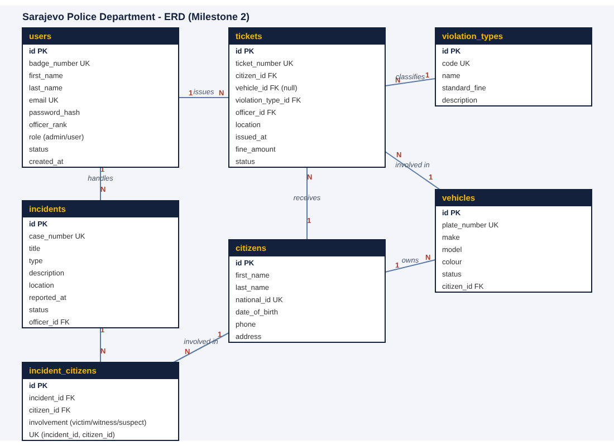

# Sarajevo Police Department Portal

Web application for a police department (course project, IT 2001 Web Programming).
A public website with login and registration, and after login a section for officers to manage incidents, tickets, citizens and vehicles. Administrators also manage officers and violation types.

**Status: Milestone 2** (MySQL database with sample data and the DAO layer). Milestone 1 delivered the project structure, the static single-page frontend and the ERD. Routes, services and the connected frontend follow in Milestones 3 and 4.

## Technology
- Frontend: HTML, CSS, JavaScript, Bootstrap 5, Chart.js, SPA with hash router
- Backend: PHP 8, PDO, MySQL (MariaDB in XAMPP); FlightPHP from Milestone 3
- API documentation (later): OpenAPI / Swagger

## Entities and relationships
ERD: [docs/erd.png](docs/erd.png) (source [docs/erd.svg](docs/erd.svg)). Database schema and sample data: [database/sarajevo_police.sql](database/sarajevo_police.sql).

| Entity | Purpose |
|---|---|
| users | Officers and administrators who log in (role: admin or user) |
| citizens | People known to the department |
| vehicles | Registered vehicles, each owned by one citizen |
| violation_types | Catalogue of violations with a standard fine |
| tickets | A fine issued by an officer to a citizen for a violation, optionally for a vehicle |
| incidents | Cases reported and handled by an officer |
| incident_citizens | Links citizens to incidents as victim, witness or suspect (many-to-many) |

Relationships: a user (officer) issues many tickets and handles many incidents; a citizen owns many vehicles and receives many tickets; a violation type classifies many tickets; a vehicle can appear on many tickets (a ticket may have no vehicle); incidents and citizens are linked many-to-many through incident_citizens.



## Roles and test accounts
The same accounts exist in the database with bcrypt-hashed passwords. Until Milestone 4 the frontend login is still a mock. All other officers in the sample data use the password `user123`.

| Role | Email | Password | Can do |
|---|---|---|---|
| admin | admin@spd.test | admin123 | Everything, including Officers and Violation types, edit and delete |
| user (officer) | officer@spd.test | user123 | View records, add incidents, tickets, citizens, vehicles |

## External API (planned, Milestone 3)
Weather for patrols (OpenWeatherMap), shown in the "Patrol weather" card on the dashboard. The card already exists with sample data.

## Run locally
The pages are loaded with `fetch()`, so open the app through a web server, not by double-clicking `index.html`.
- XAMPP: place the project in `htdocs` and open `http://localhost/<project-folder>/frontend/`
- or, with PHP installed: `php -S localhost:8000 -t frontend` and open `http://localhost:8000`

Internet access is needed for Bootstrap, Chart.js and fonts (loaded from CDNs).

### Database and DAO layer
1. Start **Apache** and **MySQL** in the XAMPP Control Panel.
2. Import `database/sarajevo_police.sql`: open http://localhost/phpmyadmin, tab **Import**, choose the file, click **Import**. It creates the database `sarajevo_police` (and drops an old copy first).
3. Copy `backend/config/config.example.php` to `backend/config/config.php` and set your MySQL user and password (XAMPP default: `root` and an empty password).
4. From the `backend` folder run:
   - `php rest/dao/test.php` – connection check; prints the number of rows in every table (6, 8, 8, 6, 10, 8, 12).
   - `php rest/dao/test_crud.php` – adds, reads, updates and deletes a row with every DAO, plus the special queries. It runs in a transaction and rolls back, so the sample data does not change.

From Milestone 3: run `composer install` in `backend/` (FlightPHP).

## Folder structure
```
frontend/   index.html, assets/ (css, js, img), views/, services/, utils/
backend/    index.php, config/, middleware/, rest/ (routes, services, dao), logs/
database/   sarajevo_police.sql (schema + sample data)
docs/       ERD, AI_LOG.md
AGENTS.md   rules for AI assistants
```

## Links
- Swagger documentation: coming in Milestone 3
- Deployed application: coming in Milestone 5
