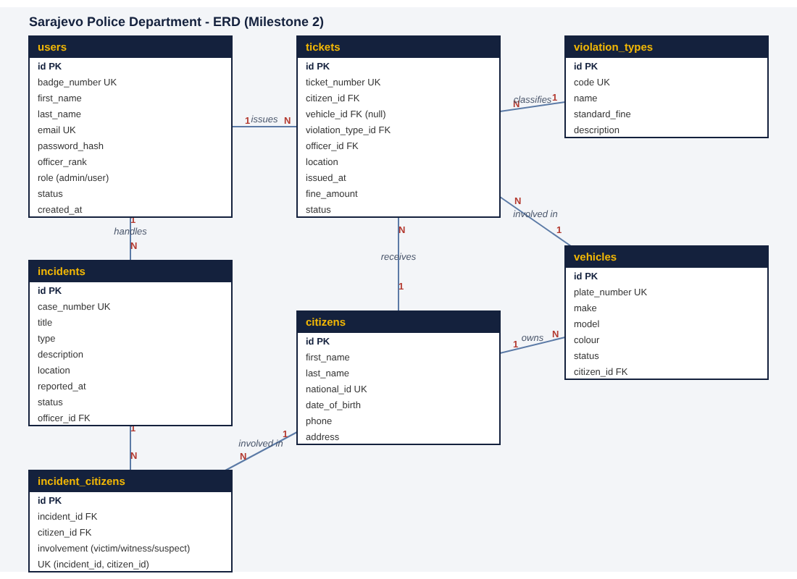

# Sarajevo Police Department Portal

Web application for a police department (course project, IT 2001 Web Programming).
A public website with login and registration, and after login a section for officers to manage incidents, tickets, citizens and vehicles. Administrators also manage officers and violation types.

**Status: Milestone 3** (business logic in services, REST API with FlightPHP, OpenAPI documentation with Swagger, external weather API). Milestone 1 delivered the project structure, the static frontend and the ERD; Milestone 2 the database and the DAO layer. Login with JWT, middleware, logging and the connected frontend follow in Milestone 4.

## Technology
- Frontend: HTML, CSS, JavaScript, Bootstrap 5, Chart.js, SPA with hash router
- Backend: PHP 8.2+, FlightPHP (REST API), PDO, MySQL (MariaDB in XAMPP)
- API documentation: OpenAPI 3 generated with swagger-php, shown in Swagger UI
- Architecture: routes (presentation) → services (business rules) → DAOs (SQL) → MySQL

## Entities and relationships
ERD: [docs/erd.png](docs/erd.png) (source [docs/erd.svg](docs/erd.svg)). Database schema and sample data: [database/sarajevo_police.sql](database/sarajevo_police.sql).

| Entity | Purpose |
|---|---|
| users | Officers and administrators who log in (role: admin or user) |
| citizens | People known to the department |
| vehicles | Registered vehicles, each owned by one citizen |
| violation_types | Catalogue of violations with a standard fine |
| tickets | A fine issued by an officer to a citizen for a violation, optionally for a vehicle |
| incidents | Cases reported and handled by an officer |
| incident_citizens | Links citizens to incidents as victim, witness or suspect (many-to-many) |

Relationships: a user (officer) issues many tickets and handles many incidents; a citizen owns many vehicles and receives many tickets; a violation type classifies many tickets; a vehicle can appear on many tickets (a ticket may have no vehicle); incidents and citizens are linked many-to-many through incident_citizens.



## Roles and test accounts
The same accounts exist in the database with bcrypt-hashed passwords. Until Milestone 4 the frontend login is still a mock. All other officers in the sample data use the password `user123`.

| Role | Email | Password | Can do |
|---|---|---|---|
| admin | admin@spd.test | admin123 | Everything, including Officers and Violation types, edit and delete |
| user (officer) | officer@spd.test | user123 | View records, add incidents, tickets, citizens, vehicles |

## External API: patrol weather (Open-Meteo)
The backend calls [Open-Meteo](https://open-meteo.com) (free, no API key) and offers the result as its own endpoint `GET /weather?days=3`: the current weather and a short forecast for Sarajevo, so officers see the road conditions before a patrol. It feeds the "Patrol weather" card on the dashboard (connected in Milestone 4).
- The frontend never calls Open-Meteo directly; the URL, the coordinates and the timeout are in `config.php`.
- Timeout of 5 s, checks of the HTTP status and of the JSON. On any failure the endpoint answers **503** with a friendly message, the reason goes to the PHP error log, and the rest of the API keeps working.
- Open-Meteo's parallel arrays and weather codes are turned into one object per day with a description ("Light rain") and a Bootstrap icon name.

## REST API
Base URL: `http://localhost/<project-folder>/backend/` (XAMPP) or `http://localhost:8000/backend/` (`php -S`). Every answer is JSON; errors always look like `{"error": "..."}` with the right status (400 broken rule, 404 not found, 503 external API down, 500 server error).

| Resource | Endpoints |
|---|---|
| Officers | `GET /users?status=pending` · `POST /users` · `GET, PUT, DELETE /users/{id}` · `GET /users/{id}/tickets` · `GET /users/{id}/incidents` |
| Citizens | `GET /citizens?search=` · `POST /citizens` · `GET, PUT, DELETE /citizens/{id}` · `GET /citizens/{id}/vehicles` · `/tickets` · `/incidents` |
| Vehicles | `GET /vehicles?status=stolen` or `?plate=` · `POST /vehicles` · `GET, PUT, DELETE /vehicles/{id}` |
| Violation types | `GET, POST /violation-types` · `GET, PUT, DELETE /violation-types/{id}` |
| Tickets | `GET /tickets?status=` · `POST /tickets` · `GET, PUT, DELETE /tickets/{id}` · `PUT /tickets/{id}/pay` · `PUT /tickets/{id}/cancel` |
| Incidents | `GET /incidents?status=` · `GET /incidents/stats` · `POST /incidents` · `GET, PUT, DELETE /incidents/{id}` · `GET /incidents/{id}/citizens` |
| Incident citizens | `GET, POST /incident-citizens` · `GET, PUT, DELETE /incident-citizens/{id}` |
| Weather | `GET /weather?days=3` |

Main business rules (in `backend/rest/services`): unique badge numbers, e-mails, national IDs, plates and violation codes; passwords stored only as bcrypt hashes; a new ticket gets the next ticket number, the current time and the standard fine of its violation; only active officers can issue tickets or handle incidents; a paid ticket cannot be cancelled; an incident under investigation needs an officer; nobody can be added to a closed incident; a citizen with vehicles, tickets or incident records and a violation type used by tickets cannot be deleted; no HTML in text fields.

All endpoints, inputs and answers are documented in Swagger UI (see Links).

## Run locally
The pages are loaded with `fetch()`, so open the app through a web server, not by double-clicking `index.html`.
- XAMPP: place the project in `htdocs` and open `http://localhost/<project-folder>/frontend/`
- or, with PHP installed: `php -S localhost:8000 -t frontend` and open `http://localhost:8000`

Internet access is needed for Bootstrap, Chart.js, Swagger UI and fonts (loaded from CDNs) and for the weather API.

### Database and DAO layer
1. Start **Apache** and **MySQL** in the XAMPP Control Panel.
2. Import `database/sarajevo_police.sql`: open http://localhost/phpmyadmin, tab **Import**, choose the file, click **Import**. It creates the database `sarajevo_police` (and drops an old copy first).
3. Copy `backend/config/config.example.php` to `backend/config/config.php` and set your MySQL user and password (XAMPP default: `root` and an empty password).
4. From the `backend` folder run:
   - `php rest/dao/test.php` – connection check; prints the number of rows in every table (6, 8, 8, 6, 10, 8, 12).
   - `php rest/dao/test_crud.php` – adds, reads, updates and deletes a row with every DAO, plus the special queries. It runs in a transaction and rolls back, so the sample data does not change.

### REST API and Swagger
1. Check that PHP is 8.2 or newer: `php -v` (swagger-php 6 needs it).
2. In the `backend` folder run `composer install`. It downloads FlightPHP and swagger-php into `backend/vendor/` (not committed) and creates `composer.lock` (committed).
3. Make sure `backend/config/config.php` has the Open-Meteo settings: copy `config.example.php` again if your `config.php` is older than Milestone 3.
4. Open the API:
   - XAMPP: `http://localhost/<project-folder>/backend/` (needs `mod_rewrite`, enabled in XAMPP by default)
   - or in the main project folder `php -S localhost:8000 server.php`, then `http://localhost:8000/backend/`
   You should see `{"app":"Sarajevo Police Department API","message":"The backend is running."}`.
5. Swagger UI: `.../backend/public/v1/docs/`. "Try it out" sends real requests: a DELETE really deletes the row (re-import the SQL file to reset the data).

## Folder structure
```
frontend/   index.html, assets/ (css, js, img), views/, services/, utils/
server.php  router for PHP's built-in web server (php -S localhost:8000 server.php)
backend/    index.php (FlightPHP), composer.json, config/, utils/ (exceptions, Validator), middleware/,
            rest/routes/ (one file per entity), rest/services/ (business rules), rest/dao/ (SQL),
            public/v1/docs/ (Swagger UI + OpenAPI attributes), logs/
database/   sarajevo_police.sql (schema + sample data)
docs/       ERD, AI_LOG.md
AGENTS.md   rules for AI assistants
```

## Links
- Swagger documentation (local): `http://localhost/<project-folder>/backend/public/v1/docs/` or `http://localhost:8000/backend/public/v1/docs/`; the public link follows with the deployment in Milestone 5
- Deployed application: coming in Milestone 5
